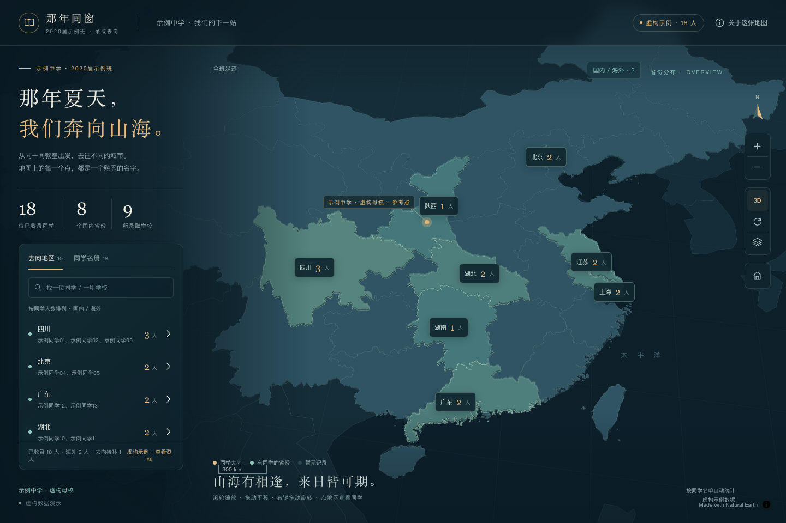
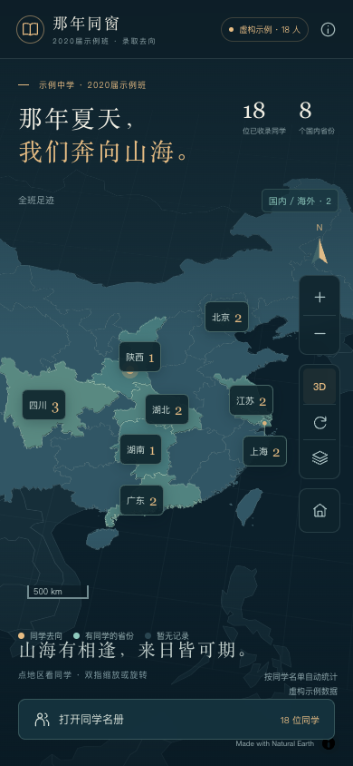

# Graduation Map Skill · 毕业去向地图

**把一张录取去向图，整理成一个能校对、能维护、能随身打开的班级地图。**

An Agent Skill and portable toolkit for turning a class roster or admission-map image into an editable, single-file interactive map. Includes a data model, page template and build tools; no API key is required for the bundled offline map.



> 本仓库的姓名、学校及其关联均为虚构演示。没有真实班级名单、私人图片或个人配置。

## 能做什么

- **图片 → 名单 → 校对 → 地图**：低清姓名保留疑点，按稳定 ID 应用用户更正。
- **由远及近查看**：省份／国家人数 → 学校聚合 → 点位、姓名和引线。
- **可旋转的立体地图**：平移、缩放、倾斜、旋转，支持手机双指操作。
- **一个 HTML 即可交付**：地图引擎、地理轮廓、业务数据、样式和逻辑内嵌。
- **数据与展示分离**：修改页面前部的数据变量并刷新，统计、名单、地图和导出同步更新。
- **容纳不完整资料**：只知道省份、学校坐标未查到、海外去向、校区不确定，都能明确展示。

| 功能 | 是否需要网络 |
|---|---|
| 生成 HTML、查看内置地图、搜索名单、缩放旋转 | 不需要 |
| 查看已内嵌的原始图片 | 不需要 |
| 学校周边道路、地名与建筑详情 | 需要，按用户操作加载 OpenFreeMap |

浏览器需要支持 WebGL。校区点是地图中的代表位置，不能仅凭学校名称推断某位同学当年的实际校区。

## 先看成品

下载仓库中的 [examples/demo.html](examples/demo.html)，用现代浏览器打开。GitHub 的文件预览不会运行 HTML；请下载文件后打开。

示例包括多人同校、国内／海外去向、缺失坐标，以及仅知道省份的记录。



## 作为 Skill 使用

技能入口是 [`skills/graduation-map/SKILL.md`](skills/graduation-map/SKILL.md)。把 **整个 `graduation-map` 目录**放入你的 Agent 支持的技能目录，或使用客户端的 GitHub skill 安装功能。具体安装位置以客户端文档为准；本仓库不修改你的全局 Agent 配置。

支持技能调用的客户端可以使用：

```text
使用 $graduation-map，把这张录取去向图片做成单页 HTML。
姓名看不清的先标注待核，学校位置和当年就读校区分开记录。
```

```text
使用 $graduation-map，按我的校对 CSV 更新姓名，保留原始证据，
并验证地图和导出数据中的人数、学校关联都同步更新。
```

这是可复用的工作流与工具，不是一个自动上传图片到云端 OCR 的服务。图像识别由所用 Agent 的视觉／OCR 能力完成，用户确认仍然是纠正模糊人名的依据。

## 不使用 Agent，也能生成页面

构建只需 **Python 3.10+ 标准库**，不需要 Node.js、npm、服务端或数据库。

```sh
git clone https://github.com/lirow/graduation-map-skill.git
cd graduation-map-skill

python3 skills/graduation-map/scripts/validate_data.py --data examples/demo-data.json
python3 skills/graduation-map/scripts/build.py \
  --data examples/demo-data.json \
  --output output/class-map.html
```

将 `examples/demo-data.json` 复制到自己的工作目录后编辑。附加本地原图时显式传入：

```sh
python3 skills/graduation-map/scripts/build.py \
  --data /path/to/my-class.json \
  --source-image /path/to/admission-map.jpg \
  --output /path/to/my-class-map.html
```

**输出 HTML 会包含名单和完整原图。**分享前检查其内容，隐藏面板不等于移除个人数据。不要把真实输入放入本公开仓库或公开 Git 历史。

## 数据怎么维护

生成后的 HTML 前部有可直接编辑的变量：

| 变量 | 负责内容 |
|---|---|
| `CLASS_INFO` | 班级、年份、名单完整性、是否为示例 |
| `ALMA_MATER` | 母校、就读校区、地址、坐标和确认状态 |
| `SCHOOLS` | 录取学校／校区，使用唯一 `id` |
| `GRADUATES` | 同学姓名及关联的 `schoolId` |
| `REGION_CONFIG` | 特殊地区的标签位置与地图名称 |
| `MAP_CONFIG` | 初始视角、缩放限制和地图资源配置 |

`CLASS_MAP_DATA` 统一引用上述对象。数据处理层计算统计，展示层负责界面和地图；没有另一份手工维护的人数汇总。

同校不同校区可以使用不同学校 ID。学校位置只维护一次；学生用 `schoolId` 关联。未知经纬度用 `null`，不会用省会坐标冒充学校点。详见 [数据字段](skills/graduation-map/references/data-schema.md)。

### 批量应用姓名校正

CSV 使用稳定 ID，不依赖排序：

```csv
id,name
demo-01,演示姓名甲
demo-02,演示姓名乙
```

```sh
python3 skills/graduation-map/scripts/import_corrections.py \
  --data examples/demo-data.json \
  --corrections examples/corrections.csv \
  --output output/corrected.json
```

工具拒绝重复 ID、未知 ID 和空姓名。再用更正后的 JSON 构建页面即可。

## 验证与开发

```sh
python3 -m unittest discover -s tests -p 'test_*.py' -v
node tests/model.cjs

# 可选浏览器回归：需要 Node.js 20+，不是用户打开页面的依赖
npm ci
npx playwright install chromium
npm run test:browser
```

浏览器回归包含离线文件打开、姓名搜索、学校／地区切换、手机按钮可点击性及 CDP 双指触摸输入。触摸模拟与实体手机测试是不同的验证，详见 [验证流程](skills/graduation-map/references/verification.md)。

## 仓库结构

```text
skills/graduation-map/
  SKILL.md                  技能入口
  agents/openai.yaml        技能界面元数据
  scripts/                  构建、数据校验、姓名校正
  references/               识图、数据规范、验证、发布说明
  assets/runtime/           页面模板、数据模型、展示逻辑
  assets/geo/               内置省级／世界轮廓
  assets/vendor/            固定版本地图引擎与许可证
examples/                   虚构数据、CSV、生成的单文件演示
tests/                      工具、数据模型与浏览器回归
docs/                       虚构示例截图
```

## 当前边界

- 中国省级地区是主要概览；海外去向使用国家标签与学校点位。
- 内置轮廓经过简化，用于分布展示，不能代替测绘数据。
- 本工具不会自动核实个人就读经历，也不会把学校现址等同于历史校区。
- 没有后台、多用户编辑或自动同步；本地编辑 JSON／HTML 后重新生成或刷新。
- 在线底图受网络和提供方可用性影响；基础地图与名单可离线使用。

## 许可与参考

原创工作流、脚本和模板使用 [MIT License](LICENSE)。MapLibre GL JS 5.6.2 保留 BSD-3-Clause 及其依赖许可证；Natural Earth 地理数据为公有领域。详见 [第三方说明](THIRD_PARTY_NOTICES.md)。

技能目录组织和说明方式参考了 [Agent Skills 示例](https://github.com/anthropics/skills) 与 [OpenAI Codex 官方技能文档](https://developers.openai.com/codex/skills/)。地图实现使用 [MapLibre GL JS](https://github.com/maplibre/maplibre-gl-js)，可选街道图层来自 [OpenFreeMap](https://openfreemap.org/)。本项目与上述项目不存在官方隶属关系。
