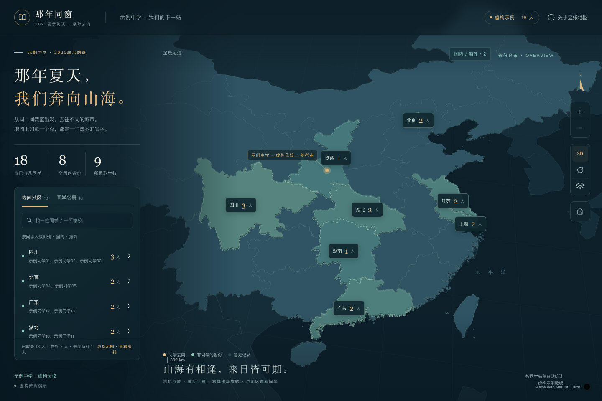

# Graduation Map Skill · 毕业去向地图

把毕业去向资料交给你的 Agent，得到能搜索、校对、旋转缩放的班级地图。

这是供 **Agent 使用的 skill**：理解资料、拆分名单、核对冲突、查证学校位置并制作成品。直接给图片、TXT、Excel、对话或混合资料，无需先写 JSON 或自行运行脚本。

公开仓库：[lirow/graduation-map-skill](https://github.com/lirow/graduation-map-skill)。
所有演示姓名、学校及其关联均为虚构。

## 安装到自己的 Agent

### 直接让 Agent 安装

将下面的话发给有文件访问能力的 Agent：

```text
请从 https://github.com/lirow/graduation-map-skill 安装 graduation-map skill。
技能在仓库的 skills/graduation-map/，请检查后将整个目录安装到
你支持的技能目录，保留 references、assets、scripts 等配套文件。
不要只复制 SKILL.md。不要覆盖同名的本地定制版本；已有安装时先比较差异。
安装后读取 SKILL.md，告诉我是否识别到此技能。
```

客户端支持 GitHub 技能安装时，仓库填 `lirow/graduation-map-skill`，子目录填 `skills/graduation-map`。

### 手动放入技能目录

下载仓库 ZIP 或克隆仓库，把 `skills/graduation-map` **整个文件夹**放入客户端支持的技能目录，最终应能找到 `技能目录/graduation-map/SKILL.md`。仓库根目录本身不是技能入口。

以 Codex 为例，可用用户级 `~/.agents/skills/graduation-map/`，或项目级 `.agents/skills/graduation-map/`。在目标不存在的前提下，macOS/Linux 可执行：

```sh
git clone https://github.com/lirow/graduation-map-skill.git
mkdir -p ~/.agents/skills
test ! -e ~/.agents/skills/graduation-map && \
  cp -R graduation-map-skill/skills/graduation-map ~/.agents/skills/graduation-map
```

已有同名目录时复制会停止，请比较后更新。其他 Agent 按其文档选择目录；不支持自动发现时可显式要求读取 `SKILL.md` 及相关参考。安装后刷新技能或新开会话。

安装路径参考：[Codex 官方技能文档](https://developers.openai.com/codex/skills/)。

## 怎样输入数据源

在 Agent 的对话中上传附件、直接粘贴文字，或提供它能访问的本地文件/文件夹。你不必使用固定模板，说明班级、届别和是否完整会更有帮助。

| 你的资料 | 给 Agent 的方式 | Agent 要做的分析 |
|---|---|---|
| 一张或多张录取图、聊天截图 | 上传图片或给本地路径 | 分区识读、数行、检查重叠，模糊姓名待核 |
| TXT / Markdown | 上传文档或粘贴原文 | 识别学校分组、一行多人和跨行记录，保留原行号 |
| Excel / CSV / TSV | 上传原始表格 | 检查多 sheet、表头、合并单元格、公式和汇总，按人对账 |
| 对话录入、后续更正 | 直接逐条发送或整段粘贴 | 区分新增/更正/确认，按稳定 ID 更新，同名先区分 |
| PDF / Word、扫描名单 | 上传文件 | 区分文字和扫描内容，处理表格、分页和重复表头 |
| 在线表格、网页、问卷/邮件导出 | 提供有权读取的链接或导出文件 | 检查分页、筛选和多次提交；权限不足时说明缺口 |
| JSON、已有地图、多文件资料包 | 给文件或文件夹 | 提取业务数据，分清版本、原始/修订/汇总，跨来源去重 |
| 语音名单 | 客户端可转写时发送 | 以转写稿分析，同音姓名和学校简称待核 |

格式支持取决于 Agent 的读取工具；读不了时应说明限制并尝试替代方式，不能声称已读取。含姓名资料的提供方式与分享范围由你决定。

### 一次给出资料，直接要成品

```text
使用 $graduation-map，分析我上传的名单.txt、毕业去向.xlsx 和两张截图。
这是 2020 届示例班，Excel“最终名单”是明细，“汇总”只用于对账；
后续我在对话里的明确更正按对应人员应用。
请先合并重复记录、列出姓名/学校/校区疑点，再交付一个可直接打开的 HTML。
未知信息保留待补，不要编造姓名或学校坐标；成品放到我指定的输出目录。
```

只给一张图片、一份表格或一段文字也可以。不要求多种资料同时具备。

### 直接在聊天里录入

```text
使用 $graduation-map，先录入这几位虚构同学：
陈一去甲大学，林二去乙大学，王三去丙大学。
这是部分名单，其他人稍后补充。先保留待补位置，做一个地图草稿。
```

Agent 会分配稳定内部 ID。以后可以继续说“把 002 的学校改成丁大学”或“再加一位同学”；无需重做整份名单。同名或指代不明确时，只暂停有歧义的修改。

### 现在没有真实数据

```text
使用 $graduation-map，我现在没有真实名单。
请解释 TXT、Excel、对话与混合资料会怎样分析，并用明确标为虚构的
少量记录演示成品。不要把虚构演练说成已经验证过我的真实数据。
```

## 会得到什么

- **单文件 HTML**：现代浏览器可直接打开；内嵌地图引擎、地理轮廓、业务数据和交互，不需要应用服务器或数据库。
- **可维护名单**：稳定人员 ID、姓名与学校/校区分离；统计、地图、名册、详情和导出读取同一份数据。
- **校对说明**：来源覆盖范围、已收录数量、仍待核的字段，以及实际完成的验证。需要时另给可编辑 JSON。
- **完整交互**：地区人数、学校点与姓名、搜索、国内/海外查看、母校连线、手机平移/缩放/双指旋转。

母校有坐标时连线默认开启，可随时关闭。**街道底图自动尝试启用**：服务可访问时显示；离线、超时或瓦片失败时静默使用内置地图，网络恢复后自动重试。无额外联网提示，手动关闭后会尊重你的选择。

| 功能 | 网络条件 |
|---|---|
| 查看内置地图、名单、搜索和交互 | 可离线 |
| 查看构建时附加的原图 | 可离线 |
| 街道、地名与建筑详情 | 自动按服务可用性加载 |
| 首次安装、补查学校地址/坐标 | 按实际工具和资料需要联网 |

姓名、历史就读校区与坐标分开确认。只知道地区也可保留；无坐标不伪造点位。只有汇总人数、没有个人名单时，Agent 可制作明确标注的汇总草稿，不能据此生成虚构的逐人名册。就业、复读等状态保留，超出当前升学模板时由 Agent 调整展示或附说明。

## 看公开示例

从仓库下载 [examples/demo.html](https://github.com/lirow/graduation-map-skill/blob/main/examples/demo.html) 后用浏览器打开；GitHub 文件预览不会执行 HTML。



示例覆盖多人同校、海外、缺失坐标和待补资料。

## Agent 如何工作

技能入口：[SKILL.md](SKILL.md)。
读取规则见 [多来源读取与拆分](references/input-sources.md)；
合并规则见 [记录合并、冲突与交付](references/reconciliation.md)；
页面字段见 [数据规范](references/data-schema.md)；
验收见 [验证流程](references/verification.md)。

`scripts/` 中的构建、校验和姓名更正工具供 Agent 按需选用，帮助稳定装配页面。它们不负责理解任意 TXT/Excel/对话，也不是一条命令全自动完成语义分析的入口。用户的正常流程是“安装 skill → 给 Agent 资料 → 校对必要疑点 → 收到成品”。

修改 HTML 前部的 `CLASS_INFO`、`ALMA_MATER`、`SCHOOLS`、`GRADUATES` 等集中数据后，保存并刷新会重新计算视图。也可直接让 Agent 根据更正重新生成。没有后台协同编辑或自动同步。

## 维护者验证

构建、工具/模型测试及浏览器检查见 [验证流程](references/verification.md)。浏览器检查使用 Node.js 20+、Playwright 和 Chromium，覆盖离线文件、手机交互、触摸模拟及受控网络下的街道自动开启和静默回退。用户打开成品无需这些开发依赖；虚构分析演练不等于真实文件读取测试。

## 分享与许可

真实名单和附加原图会嵌入 HTML；分享前按需要脱敏，不要放入本公开仓库。公开 skill 不表示授权公开某个班级的数据。

原创技能、模板与辅助工具采用 MIT；MapLibre GL JS 5.6.2 和 Natural Earth 等来源保留各自许可。来源及边界见公开仓库 `THIRD_PARTY_NOTICES.md`。内置轮廓是分布展示参考，不用于测绘，也不证明某个人的实际就读经历。

> 维护约定：本地技能目录是维护源，GitHub 为分发副本。README 以 Agent 安装、资料输入和成品交付为主；原脚本使用细节见验证参考，勿恢复为主要入口。
